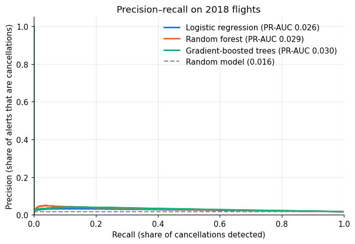
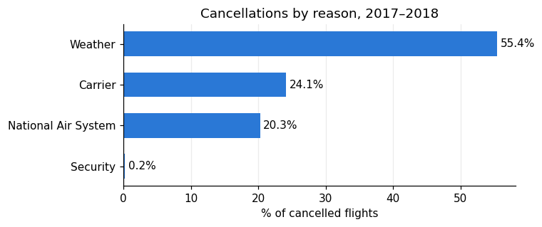

# Predicting Flight Cancellations with PySpark

Can we tell, before departure, which US domestic flights are likely to be cancelled?
This project uses 12.9 million flights from 2017 and 2018 and Spark MLlib to find out.

**Tools:** Python · PySpark (Spark MLlib) · pandas · scikit-learn · matplotlib · Google Colab

## Context

This started as a group project for the Big Data course of the Master's in Data Analytics and Decision Support Systems
at ISCAC – Coimbra Business School, developed with Ana Rita Gonçalves and João Vasco Marreiros.

This repository is my revised version. In the original submission, four models (random forest, neural network, SVM and
gradient-boosted trees) reported 98.5% accuracy and weighted F1 of 0.977. Reviewing it later, I realised those numbers
meant nothing: only 1.5% of flights are cancelled, so a model that predicts "not cancelled" for every flight gets exactly
98.5% accuracy, and the confusion matrices confirmed the models were doing just that.

The revision rebuilds the analysis around that problem.

## What changed

| | Original | Revised |
|---|---|---|
| Features | Included `DIVERTED`, only known after the flight | Only information available at scheduling time |
| Validation | Random 80/20 split | Train on 2017, test on 2018 |
| Class imbalance | Not handled | Class weights in every model |
| Metrics | Accuracy and weighted precision/recall/F1 | Precision, recall and F1 for cancellations, PR-AUC, recall in the top 5% riskiest flights |
| Decision threshold | Default 0.5 | Chosen on a 2017 validation set |

## Results

Models trained on a 30% sample of 2017 (1.5 million flights) and tested on all 7.2 million flights of 2018, of which 1.62% were cancelled.
Precision, recall and F1 refer to the cancelled class, at the threshold chosen on 2017 validation data.

| Model (test set: 2018) | ROC-AUC | PR-AUC | Precision | Recall | F1 | Accuracy | Recall in top 5% |
|---|---|---|---|---|---|---|---|
| Always "not cancelled" | 0.500 | 0.016 | – | 0.000 | 0.000 | **0.984** | 5.0% |
| Logistic regression | 0.634 | 0.026 | 0.032 | 0.140 | 0.052 | 0.918 | 10.0% |
| Random forest | 0.662 | 0.029 | 0.042 | 0.013 | 0.019 | 0.979 | **12.9%** |
| Gradient-boosted trees | **0.669** | **0.030** | 0.039 | 0.076 | 0.051 | 0.954 | 12.6% |

- **The accuracy trap.** The do-nothing baseline has the highest accuracy of all, and its weighted precision, recall and F1 (0.968 / 0.984 / 0.976) match the values the original report presented as good results.
- **A modest but real signal.** The best PR-AUC is about twice that of a random model (0.016), and the 5% riskiest flights contain about 13% of all cancellations, 2.5 times what a random pick would catch. As a ranking tool this has some value; as a yes/no alarm it is weak (about 3 to 4 real cancellations in every 100 alerts).
- **Why it stays modest.** Weather causes 55% of cancellations and the data has no weather information. The models lean on airports, month and day of the month, which partly captures which periods of 2017 were bad and does not carry over to 2018; this is also why the thresholds chosen on 2017 transfer poorly.





## Main lessons

- With heavily imbalanced classes, accuracy and class-weighted metrics describe the majority class and hide a model that never detects the event of interest.
- Leakage is easy to miss: any variable recorded after the outcome (diversion, actual times, delays) has to stay out of the features.
- A time-based split is a stricter and more honest test than a random split: patterns learned from one year do not always repeat in the next.
- The next step that would matter most is adding weather forecasts per airport and day.

## Repository structure

```
notebooks/flight_cancellation_prediction.ipynb   full analysis
data/README.md                                   how to get the data
figures/                                         charts produced by the notebook
results/                                         metrics produced by the notebook
requirements.txt
```

## How to run

1. Download `2017.csv` and `2018.csv` as described in [data/README.md](data/README.md).
2. Open the notebook in Google Colab (or locally with Java 11+ and the packages in `requirements.txt`).
3. Set `DATA_DIR` in the first cell to the folder with the CSV files and run all cells.
   On the free Colab runtime, training takes a while; `TRAIN_FRACTION` lets you train on part of 2017.

## Data

*Airline Delay and Cancellation Data, 2009–2018*, published on Kaggle by the user yuanyuwendymu and compiled from the US Bureau of
Transportation Statistics. The data is not included in this repository because of its size (≈1.6 GB for the two years).
